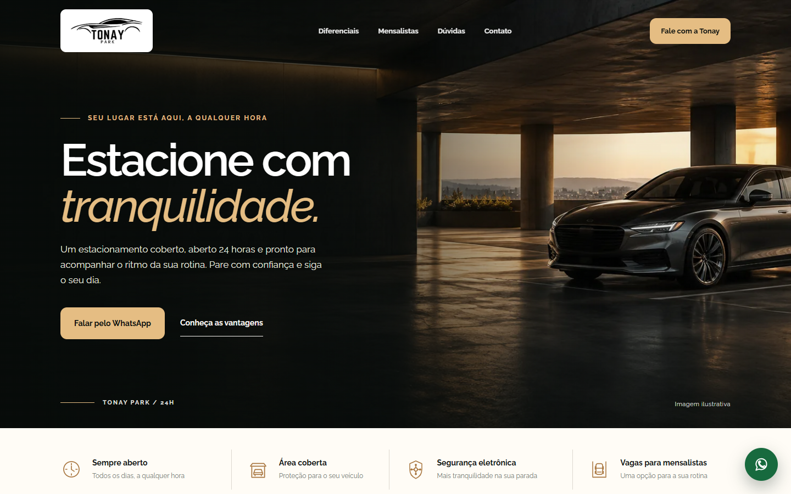

# Tonay Park — Landing Page

Landing page responsiva para apresentar um estacionamento em Botafogo, Rio de Janeiro. O visual combina tons escuros e dourados, tipografia Raleway e navegação simples para levar o visitante ao contato pelo WhatsApp.

**[Ver o site publicado](https://tonay-park-botafogo.netlify.app/)**



## Funcionalidades

- Informações sobre funcionamento 24 horas, área coberta, segurança eletrônica e vagas para mensalistas.
- Links de WhatsApp com mensagens diferentes para contato geral e consulta de vaga mensal.
- Botão flutuante de WhatsApp, menu para celular e seção de dúvidas frequentes.
- Animação discreta ao rolar a página, respeitando a preferência por movimento reduzido.
- Layout responsivo feito com HTML, CSS e JavaScript, sem dependências de framework.
- Favicon próprio com o símbolo do carro.

## Rodar localmente

Abra `index.html` no navegador. Os arquivos de fonte estão em `assets/fonts/` e a licença da fonte está em `assets/fonts/OFL.txt`.

## Configuração

O número do WhatsApp no projeto é **provisório**. Para colocar o número definitivo, altere estas duas linhas no início de `script.js`:

```js
const whatsappNumber = '552199999999';
const whatsappDisplay = '(21) 9999-9999';
```

Em `whatsappNumber`, use código do país, DDD e número, sem espaços ou símbolos.

## Publicação

O site está hospedado no Netlify. A pasta `dist/` é gerada localmente com `index.html`, `styles.css`, `script.js` e `assets/`, e não faz parte do repositório. Após alterações, atualize esses arquivos em `dist/` e execute `netlify deploy --prod --dir=dist`.

A fotografia da página é ilustrativa.
